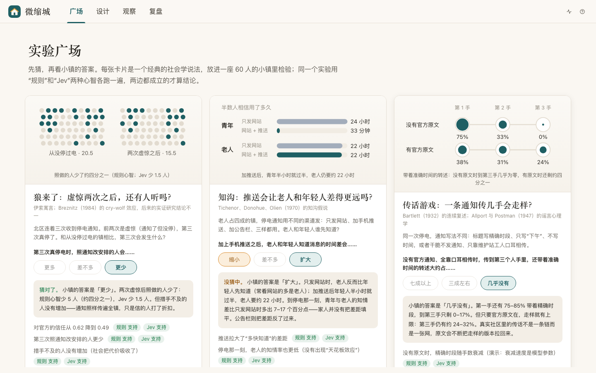
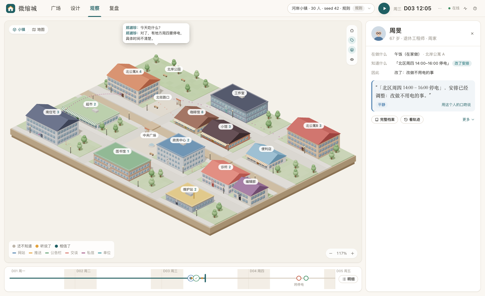

# MicroCity

[中文](README.md) · **English**

A miniature town of 30–60 residents, built for social experiments.

Send a power-outage notice into it, then watch:
- how each resident hears about it, what they understand, whether they believe it, whether they change their plans, and who they tell next;
- a few days later, whether anyone has changed their mind, and how trust between neighbours, and between residents and officials, has shifted.

Click on anyone to see **why they know, why they chose what they chose, and what they didn't choose**. A finding only counts if it holds across many random seeds and under two different "minds" (a rule-based mind and Jev).

- **Live demo**: <https://microcity.linjiejim.com> (guess first, then run; visitors get the rule-based mind only)
- **Experiments so far**: [docs/experiments](docs/experiments/README.md)
- **Contributing**: [CONTRIBUTING.md](CONTRIBUTING.md)

> The interface, the town templates and the docs are in Chinese. The code, the experiment manifest format and the commands are language-neutral.



## What it has found

Every row is "a finding under this model". Hypotheses were written down and committed before running (pre-registration).

| Question | The town's answer |
| --- | --- |
| **The boy who cried wolf**: after two false alarms, does anyone still listen? | On the third, real outage, fewer people changed their plans as the notice said (5 fewer under the rule mind, 1.5 fewer under Jev), yet nobody was caught more off guard: the notice still reached the whole town. False alarms hurt trust and compliance more than missed warnings. |
| **Knowledge gap**: do push notifications widen the gap between old and young? | Yes, and not only in speed: with push added, the young–old gap in who knew at the moment of the outage grew by 7–17 points over website-only, and families did not close it. A notice board reverses the gap. |
| **Telephone game**: how many hand-offs before a notice gets garbled? | Without the official text, by the third hand-off only 0–17% of retellings still carry the exact time. With the original available, distortion is bounded: retelling is a network, and the original keeps pulling it back. |
| **Channel vs wording**: does a clearer notice spare people trouble? | Push cuts the time until half the town believes from hours to minutes under every parameter set; whether clear wording spares people trouble depends on the model and on luck. |
| **The cost of silence**: if officials fail to warn once, are they trusted next time? | Trust falls with every repetition, but behaviour barely moves: neighbours fill the gap, and people who were burned become more careful. The model has no tipping point where people stop believing officials; that is the finding most in need of real-world data. |

Details:
- [Calibration and social experiments](docs/experiments/20260929-calibration-and-social-experiments.md)
- [Classic cases: cry wolf, knowledge gap, telephone game](docs/experiments/20260929-classic-cases.md)

## Five-minute start

**No install**: open the demo's gallery, pick a card, guess, see the answer, click "rerun here", then "copy and edit" to make it your own experiment.

**Locally** (Node 22+, pnpm):

```bash
pnpm install
```

```bash
pnpm dev
```

Open http://127.0.0.1:5318. The server runs on 5317 and the Vite front end on 5318 (proxying `/api`).

No keys are needed. To let residents decide with Jev, and to use DeepSeek for building towns by conversation and writing reports, create `.env.local` in the repo root with an OpenRouter key (never committed). Spending is capped by budget gates:

```bash
cp .env.example .env.local
```

## Four workspaces

Switch in the top bar, or press `G` / `D` / `O` / `R`.



1. **Gallery**: does this claim hold in the town?
   - Each card is a classic claim from sociology. Guess first (no hints before you guess), then see the town's answer, a figure, and the verdict under both minds.
   - Rerun it in one click, or copy it into your own experiment.
2. **Design**: what kind of town, and what kind of notice?
   - Describe it in one sentence, e.g. "an old quarter of 40 people, mostly elderly, few push subscribers, notice only on the board"; or pick a template, or drag parameters under "more settings".
   - Up to three rounds per script: when each outage happens, which channels, whether the headline is clear, whether there is a clarification, or whether it is a false alarm.
3. **Observe**: where has the news reached right now?
   - Two views of the town: a 3D miniature or a flat map. The colour under each resident means "doesn't know yet / has heard / believes".
   - On the right, one big number (how many people know) and key beats, like "10:12 Ma Fang retold 'afternoon' as 'all day'".
   - Click a person to see what they are doing, what they know, what they did because of it, and what they are thinking; more in the full profile.
4. **Review**: what changed, and why?
   - **Reaction wall**: one card per person — what they know now, what they think, and what changed since the baseline.
   - **Society**: belief and trust curves, the who-told-whom network, the funnel.
   - **Compare**: first the question and the verdict on the predictions written in advance (supported / partly / not supported), then medians, quartiles and per-seed pairs across seeds × branches.
   - **Report**: the LLM may only cite numbers, times and names from a fact table; if validation fails, it falls back to a template report.

## Your own experiment

An experiment is one file (an experiment manifest). Edit it under "New comparison → use a manifest (JSON)", or via "copy and edit" in the gallery:

```json
{
  "name": "Is push faster?",
  "question": "Does adding push make people know sooner?",
  "seeds": [1, 2, 3, 4, 5],
  "branches": {
    "A": { "label": "Website only", "patches": [{ "event": "$first", "channels": ["website"] }] },
    "C": { "label": "Website + push", "patches": [{ "event": "$first", "channels": ["website", "push"] }] }
  },
  "predictions": [
    { "id": "P1", "text": "With push, half the town believes sooner", "metric": "E1.t50", "a": "C", "b": "A", "expect": "lower" }
  ]
}
```

What a branch can change:
- one round of the event (`patches`): channels `channels`; headline `headline` (exact / coarse / none); no notice `silent`; clarification `clarify`; false alarm or no event at all `mode` (false_alarm / absent);
- a different town (`town`): culture, media, social network, population;
- mind parameters (`params`).

Each prediction is judged on per-seed pairs: if the expected direction holds in ≥ 70% of pairs, it is "supported".

To turn it into a write-up that holds up, follow the [template](docs/experiments/TEMPLATE.md): pre-register first, then run.

## How it works

```
packages/sim   deterministic core (no IO, shared by server and browser): clock and scheduler, map and
               pathfinding, daily routines, money and stock, structured claims / versions / retelling
               distortions, understanding and belief, a seven-stage funnel, candidates + utility + sampling,
               trust and remembered experiences, event scripts (incl. false alarms), town generation from
               templates, profiles / thoughts / curves, invariants, metrics
apps/server    Node: run management, SQLite event store and snapshots, HTTP + WebSocket, Jev / DeepSeek
               adapters, scenario registry, town-building sessions, multi-seed experiments and prediction
               verdicts, gallery, review computations, reports, public demo mode
apps/web       React + react-three-fiber: gallery / design / observe / review; 3D miniature and flat map,
               conclusion-first charts
```

- **Rules decide the world.**
  - Money, stock, opening hours and outages are executed as events in the core, and are conserved.
  - Residents can only pick among legal candidates. If they want to change plans but can't, that is recorded as "intended but blocked", with the reason.
- **Claims are slot structures**: event, place, date, time window, source, certainty, advice.
  - Someone who only saw the headline doesn't get the details in the body.
  - Rumours can only arise from recorded retelling distortions: leaving things out, going vague, or, when anxious, filling a missing time window with "all day".
- **Trust and experience.**
  - Once the truth is visible (the power cuts out, or in a false alarm it never does), witnesses adjust trust by a rule table and remember the experience, which shapes how worried they are next time, whether they verify, and whether they comply.
  - The magnitudes come from a Jev trust panel (30 residents × 13 kinds of experience), not hand-set values.
- **Two minds.**
  - The rule mind is free and runs in seconds; it does the heavy lifting for multi-seed, multi-town experiments. Its semantic factors were fitted to over two thousand real Jev decisions.
  - The Jev mind (`typesafe/jev-1.13`, a behavioural model) only answers semantic factors (personality fit, worry, whether to verify, whether to tell someone). The choice itself is made by an explicit utility plus softmax sampling.
- **Everything is an event.**
  - The front end rebuilds state with the same reducer; "initial state + event log" replays to the same hash.
  - A fork is a snapshot plus only the declared intervention. Random numbers are derived from keys, so one extra draw in a branch doesn't shift anything elsewhere.
- **Generated text is for display only.** Dialogue, monologues and reports are validated, may not go beyond the facts, and are never written back into anyone's memory.

Design and decision records (in Chinese) live in [docs/specs](docs/specs/README.md): v0 outage loop; v1 social lab; v2 calibration and parameterised experiments; v3 classic cases and sharing; v4 visual language.

## Tests

```bash
pnpm check
```

Type checks, lint, and vitest:
- core: zero violations under soak, determinism, event replay, snapshots and forks, knowledge isolation, trust and experience, false alarms;
- server: API, multi-seed experiments and prediction verdicts, demo-mode limits and cleanup, gallery;
- model paths: tested with fixtures.

```bash
pnpm e2e
```

Playwright brings up an isolated server and front end offline and walks through the main flows of all four workspaces. Screenshots go to `test-results/screens/`.

The smoke test that makes one real Jev call is skipped by default:

```bash
LIVE=1 npx vitest run apps/server/test/jev.test.ts
```

## Models and cost

| Use | Model (OpenRouter) | Typical cost |
| --- | --- | --- |
| Residents' semantic factors | `typesafe/jev-1.13` | one branch × one seed of a 60-person town: ~$0.003–0.01 |
| Building towns by conversation | `deepseek/deepseek-v4-flash`, no reasoning, JSON output | ~$0.0005 per turn |
| Experiment reports | same | ~$0.0004 each |
| Dialogue / monologue (display only) | same | ~$0.00004 each |

Budget gates: $0.50 per run and $3 in total by default; beyond that it falls back to rules or templates and marks it in the record.

## Configuration

| Variable | Default | Meaning |
| --- | --- | --- |
| `OPENROUTER_API_KEY` | empty | without it, only rule decisions and templates |
| `MICROCITY_PORT` / `MICROCITY_WEB_PORT` | 5317 / 5318 | server / front-end ports |
| `MICROCITY_DATA` | `data` | SQLite directory (gitignored) |
| `MICROCITY_JEV_MODEL` / `MICROCITY_GEN_MODEL` | `typesafe/jev-1.13` / `deepseek/deepseek-v4-flash` | pinned versions |
| `MICROCITY_RUN_BUDGET` / `MICROCITY_GLOBAL_BUDGET` | 0.5 / 3 | US dollars |
| `MICROCITY_OFFLINE` | empty | `1` disables all model calls |
| `MICROCITY_PUBLIC` | empty | `1` turns on public demo mode (see [DEPLOY.md](DEPLOY.md)) |
| `MICROCITY_STATIC_DIR` | empty | in production the server serves the built front end, e.g. `apps/web/dist` |

## Limits

This is a sandbox of synthetic people, not a predictor of reality.
- A single run is one synthetic trajectory; conclusions come from the distribution over seeds.
- A difference between branches is "a difference under this model", not a real policy effect.
- Retelling, attention and trust parameters have not been calibrated against real-world data. What we did is calibrate against Jev, and Jev is a behavioural model, not reality.
- Some classics can only be demonstrated here, not tested: the result just reads a parameter back out. The experiment write-ups flag these.

## License

[MIT](LICENSE)
