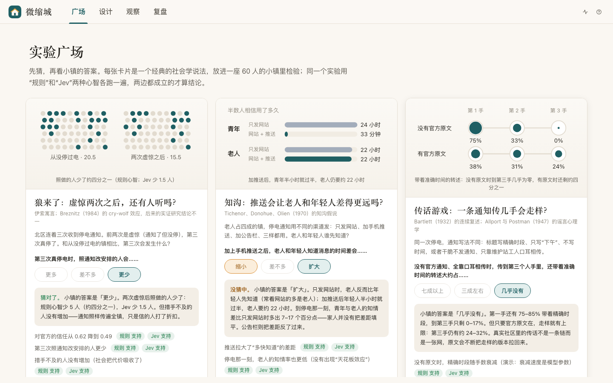
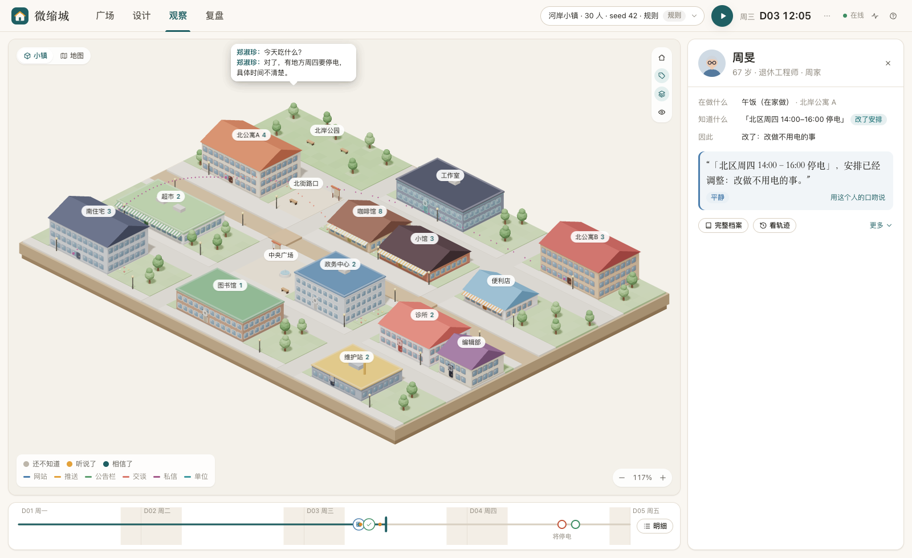

# 微缩城 MicroCity

**中文** · [English](README.en.md)

一座 30–60 人的微缩小镇，用来做社会实验。

发一条停电通知进去：
- 看每个居民怎样得知、怎样理解、信不信、改不改安排、又告诉了谁；
- 过几天再看，每个人的想法变了没有，人与人、人与官方之间的信任怎样变化。

点任何一个人，都能看到他**为什么知道、为什么这样选、没选的是什么**。每条结论都要在多个随机种子、两种“心智”（规则 / Jev）下成立才算数。

- **演示站**：<https://microcity.linjiejim.com>（先猜，再跑；访客只开放规则模式）
- **做过的实验**：[docs/experiments](docs/experiments/README.md)
- **参与**：[CONTRIBUTING.md](CONTRIBUTING.md)



## 用它做过什么

都是“这个模型下的结论”。假设写在运行之前，并单独提交（预注册）。

| 问题 | 小镇的答案 |
| --- | --- |
| **狼来了**：虚惊两次之后，还有人听吗？ | 第三次真停电时，照通知改安排的人少了（规则心智少 5 人，Jev 少 1.5 人），但没有人更措手不及——通知照样传遍全镇。虚报比漏报更伤信任，也更伤照做。 |
| **知沟**：推送会让老人和年轻人差得更远吗？ | 会，而且不止快慢：加推送后，停电那一刻青年与老人的知情差比只发网站时多出 7–17 个百分点，家人并没有把差距填平。公告栏则把差距反过来。 |
| **传话游戏**：一条通知传几手会走样？ | 没有官方原文时，传到第三手，带着准确时间的转述只剩 0–17%；有原文在，走样有上限——传话是一张网，原文会不断把走样拉回来。 |
| **渠道 vs 措辞**：把通知写清楚，能让大家少折腾吗？ | 推送让半数人相信的时间从小时缩到分钟，在任何参数下都成立；“写清楚能少折腾”却取决于模型和运气。 |
| **失信的代价**：该通知没通知，下次还信吗？ | 信任在每一次重复里都下降，行为却几乎不变：邻里补位，被坑过的人反而更谨慎。模型里没有“不再相信官方”的临界点——这是最该用现实数据检验的一条。 |

详见：
- [校准与社会实验](docs/experiments/20260929-calibration-and-social-experiments.md)
- [经典实验复现：狼来了、知沟、传话游戏](docs/experiments/20260929-classic-cases.md)

## 五分钟上手

**不装环境**：打开演示站的“广场”，挑一张卡片先猜，看答案，点“在这里重跑”，再点“复制并修改”，改成你自己的实验。

**在本机**：

```bash
pnpm install
```

```bash
pnpm dev
```

打开 http://127.0.0.1:5318 。服务端在 5317，前端 Vite 在 5318（代理 `/api`）。

不需要任何密钥就能用。想让居民用 Jev 做决策、用 DeepSeek 对话建镇与写报告，在仓库根目录建 `.env.local` 填入 OpenRouter 密钥（不进仓库），花费有预算闸：

```bash
cp .env.example .env.local
```

## 四个工作区

顶栏切换，快捷键 `G` / `D` / `O` / `R`。



1. **广场**：这个说法在小镇里成立吗？
   - 每张卡片是一个经典的社会学说法：先猜（猜之前不给任何提示），再看小镇的答案、示意图，以及两种心智下的判定。
   - 可以一键重跑，也可以复制一份改成自己的实验。
2. **设计**：我要一座什么样的镇、发一条什么样的通知？
   - 用一句话描述，例如“40 人的老城区，老人多，很少有人订推送，通知只贴公告栏”；也可以换模板，或在“更多设置”里拖参数。
   - 剧本最多 3 轮：每一轮停电的时间、通知渠道、标题写不写清楚、要不要澄清，或者干脆是一场虚惊。
3. **观察**：消息此刻传到哪了？
   - 城市有两种看法：3D 微缩小镇，或者平面地图；每个居民脚下的颜色表示“还不知道 / 听说了 / 相信了”。
   - 右侧一个大数字（多少人已经知道）和关键节拍，例如“10:12 马芳把‘下午’说成了‘一整天’”。
   - 点一个人，看此刻在做什么、知道什么、因此做了什么，以及心里的想法；更多细节在“完整档案”。
4. **复盘**：发生了什么变化，为什么？
   - **反应墙**：每人一张卡，写着此刻知道什么、在想什么，和基准时刻相比变了什么。
   - **社会**：信念与信任的曲线、谁告诉了谁的网络、漏斗。
   - **对照**：先给问题和事先写下的预测的判定（支持 / 部分支持 / 不支持），再看多个随机种子 × 多个分支的中位数、四分位与逐 seed 配对。
   - **报告**：LLM 只能引用事实表里的数字、时刻和人名；校验不过就退回模板报告。

## 做你自己的实验

一个实验就是一个文件（实验清单），在“新建对照实验 → 用实验清单（JSON）”或广场的“复制并修改”里编辑：

```json
{
  "name": "推送快不快",
  "question": "加推送能不能让人更早知道？",
  "seeds": [1, 2, 3, 4, 5],
  "branches": {
    "A": { "label": "仅网站", "patches": [{ "event": "$first", "channels": ["website"] }] },
    "C": { "label": "网站 + 推送", "patches": [{ "event": "$first", "channels": ["website", "push"] }] }
  },
  "predictions": [
    { "id": "P1", "text": "加推送后半数人更早相信", "metric": "E1.t50", "a": "C", "b": "A", "expect": "lower" }
  ]
}
```

分支能改的东西：
- 一轮事件（`patches`）：
  - 渠道 `channels`；
  - 标题 `headline`：exact / coarse / none；
  - 不发通知 `silent`；
  - 澄清 `clarify`；
  - 虚惊或不存在 `mode`：false_alarm / absent。
- 换一座镇（`town`）：文化、媒介、关系网、人口。
- 换心智参数（`params`）。

跑完后，每条预测按逐 seed 配对判定：方向在 ≥ 70% 的配对里成立为“支持”。

想写成一份站得住的实验记录，按 [模板](docs/experiments/TEMPLATE.md) 先预注册、再跑。

## 它是怎么工作的

```
packages/sim   确定性内核（无 IO，前后端同构）：时钟与调度、地图寻路、日程、钱与库存、
               结构化主张/版本/转述变形、理解与信念、七阶段漏斗、候选+效用+抽样、
               信任与经历记忆、事件剧本（含虚惊）、按模板生成小镇、画像/想法/曲线、不变量、指标
apps/server    Node：运行管理、SQLite 事件库与快照、HTTP + WebSocket、Jev / DeepSeek 适配、
               场景登记、建镇会话、多 seed 实验与预测判定、实验广场、复盘计算、报告、公开演示站模式
apps/web       React + react-three-fiber：广场 / 设计 / 观察 / 复盘；3D 微缩小镇与平面地图，结论先行的图表
```

- **世界由规则裁决**：
  - 钱、库存、营业、停电都在内核里按事件执行并守恒。
  - 居民只能在合法候选里选；想改但改不成的，记为“有意但受阻”，并写明原因。
- **主张是槽位结构**：事件、地点、日期、时段、来源、确定度、建议。
  - 看标题的人拿不到正文里的细节。
  - 谣言只能由记录在案的转述变形产生：漏说、说模糊、焦虑时把缺失的时段补成“全天”。
- **信任与经历**：
  - 真相被看见后（来电，或者虚惊时电一直没断），见证者按规则表调整信任，并记下这次经历，影响下一轮的担心、查证和照不照做。
  - 幅度来自 Jev 信任面板（30 位居民 × 13 种经历），不是手设的。
- **两种心智**：
  - 规则心智免费、秒级，是多 seed、多座镇实验的主力，它的语义因子向 Jev 的两千多个真实决策拟合过。
  - Jev 心智（`typesafe/jev-1.13`）只回答语义因子（人格契合、担心、想不想查证、会不会主动通知谁）；选择由显式效用加 softmax 抽样完成。
- **一切皆事件**：
  - 前端用同一个 reducer 重建状态；“初始状态 + 事件日志”可重放出同一哈希；
  - 分叉 = 快照 + 只改声明的干预；随机数按键计算，分支里多一次抽样不会让别处错位。
- **生成文字只供展示**：台词、独白、报告都经过校验，不许超出事实，也不回写任何人的记忆。

设计与决定记录见 [docs/specs](docs/specs/README.md)：
- v0 停电闭环；
- v1 社会实验室；
- v2 校准与参数化实验；
- v3 经典案例与分享。

## 测试

```bash
pnpm check
```

`pnpm check` 包括类型检查、lint，以及 vitest：
- 内核：浸泡零违例、确定性、事件重放、快照与分叉、知识隔离、信任与经历、虚惊；
- 服务端：接口、多 seed 实验与预测判定、演示站限制与清理、实验广场；
- 模型路径：用夹具测试。

```bash
pnpm e2e
```

Playwright 离线起一套独立的服务端与前端，走完广场、设计、观察、复盘的主要流程。截图存 `test-results/screens/`。

真实调用一次 Jev 的冒烟用例默认跳过：

```bash
LIVE=1 npx vitest run apps/server/test/jev.test.ts
```

## 常用脚本

| 脚本 | 用途 |
| --- | --- |
| `node --import tsx scripts/smoke.ts "D04 20:00"` | 内核冒烟：跑到指定时刻，打印不变量、溯源、漏斗、后果与前 40 次决策 |
| `node --import tsx --no-warnings scripts/lab/sens.ts` | 参数敏感性：14 个参数一次改一个 + 200 组随机参数，约 2 万次运行、3 分钟 |
| `node --import tsx --no-warnings scripts/lab/cases.ts rule` | 经典案例：3 座实验镇 × 20 seed，按预注册的规则判定 |
| `node --import tsx --no-warnings scripts/lab/cases.ts ui W jev` | 把实验登记到主库并用 Jev 跑（先停 dev 服务），之后在“对照”里打开 |
| `node --import tsx --no-warnings scripts/lab/gallery.ts` | 由案例定义生成实验广场的内容 |
| `node --import tsx scripts/shot.ts <url> <out.png>` | 全分辨率截图 |

## 模型与费用

| 用途 | 模型（OpenRouter） | 典型花费 |
| --- | --- | --- |
| 居民的语义因子 | `typesafe/jev-1.13`（System One API） | 60 人小镇的一个分支、一个 seed 约 $0.003–0.01 |
| 对话建镇 | `deepseek/deepseek-v4-flash`，不开推理，JSON 输出 | 每轮约 $0.0005 |
| 实验报告 | 同上 | 每份约 $0.0004 |
| 台词 / 独白（仅展示） | 同上 | 每条约 $0.00004 |

预算闸：每次运行默认上限 $0.50，全局累计上限 $3；超过后自动回退到规则或模板，并在记录里标记。

## 配置

| 变量 | 默认 | 说明 |
| --- | --- | --- |
| `OPENROUTER_API_KEY` | 空 | 没有就只能用规则决策与模板 |
| `MICROCITY_PORT` / `MICROCITY_WEB_PORT` | 5317 / 5318 | 服务端 / 前端端口 |
| `MICROCITY_DATA` | `data` | SQLite 目录（已 gitignore） |
| `MICROCITY_JEV_MODEL` / `MICROCITY_GEN_MODEL` | `typesafe/jev-1.13` / `deepseek/deepseek-v4-flash` | 钉住版本 |
| `MICROCITY_RUN_BUDGET` / `MICROCITY_GLOBAL_BUDGET` | 0.5 / 3 | 美元 |
| `MICROCITY_OFFLINE` | 空 | 设为 `1` 时不调用任何模型 |
| `MICROCITY_PUBLIC` | 空 | 设为 `1` 进入公开演示站模式（见 [DEPLOY.md](DEPLOY.md)） |
| `MICROCITY_STATIC_DIR` | 空 | 生产环境由服务端提供构建好的前端，例如 `apps/web/dist` |

## 边界

这是合成人物的实验沙盘，不是现实预测器。
- 单次运行只是一条合成轨迹，结论要看多个 seed 的分布。
- 分支差异是“这个模型下的差异”，不是现实政策效应。
- 转述、注意、信任的参数没有用现实数据校准过。我们做的是“向 Jev 校准”，而 Jev 是一个行为模型，不是现实。
- 有的经典在这里只能演示、不能检验：结果只是把某个参数读回来的，实验记录里都标了。

## 许可证

[MIT](LICENSE)
